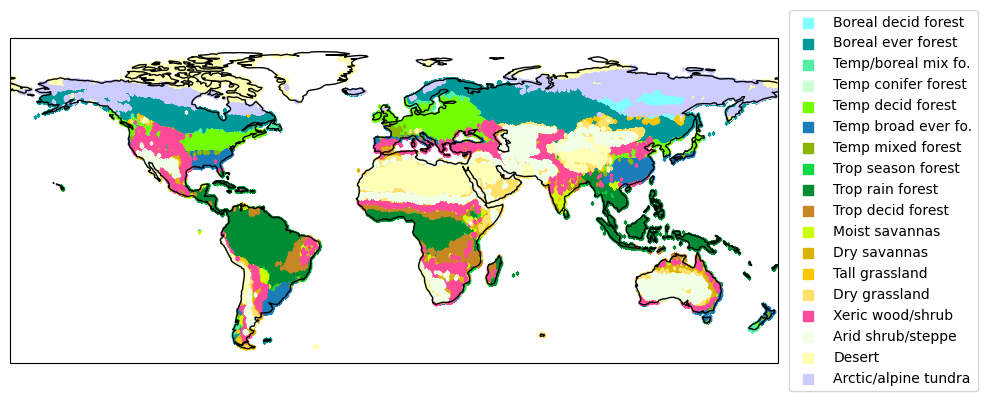

# Random forest biome modelling

This BERN01 course project uses climate summaries and soil properties to classify observed biomes with random forests. It compares performance across geographic regions and on a global random split. It also trains random forest regressors to estimate vegetation carbon (VegC) and net primary productivity (NPP) using LPJ-GUESS outputs as targets.



*Observed biome classes plotted in the original notebook.*

The BERN01 Exercise 2 handout, *Using random forest machine learning to predict plant geography and carbon fluxes*, describes the input grid as 0.5° latitude by 0.5° longitude. The notebook follows the exercise's progression from binary classification to multiclass classification and regression. It compares multiclass predictions with the LPJ-GUESS biome estimates based on maximum biomass and leaf area index.

## Run the notebook

Use Python 3.11. From the repository folder, run the following in a Windows terminal.

```powershell
python -m venv .venv
.venv\Scripts\python.exe -m pip install -r requirements.txt
.venv\Scripts\python.exe -m jupyterlab Biome_exercise.ipynb
```

On macOS or Linux, use `.venv/bin/python` in place of `.venv\Scripts\python.exe`. Select the Python kernel for this environment and run the notebook from top to bottom. Use the data setup below first. Cartopy may download Natural Earth coastlines the first time it draws a map. Variance inflation factor (VIF) calculations, grid searches, and SHAP explanations can take time.

## Data

This local copy already contains the nine required files in `data/`, extracted from `project2_data.zip`.

| Input | Files |
| --- | --- |
| Seasonal climate summaries, 1961–1990 | `Tswrfdaymean1961_1990_stats.csv`, `Tmpdaymean1961_1990_stats.csv`, `Tmindaymean1961_1990_stats.csv`, `Tmaxdaymean1961_1990_stats.csv`, `Predaymean1961_1990_stats.csv` |
| Biome observations and LPJ-GUESS outputs | `LPJ-GUESS_output_BERN1.csv` |
| Soil properties | `soilmap.dat` or `soilmap2.dat` |
| Legend and geographic labels | `legend of biomes.txt` or `legend-of-biomes.txt`, plus `gridlist_pan_gfed_ISO3_UN.txt` |

The original notebook attributes the biome observations to Haxeltine & Prentice (1996). If your files already sit together elsewhere, set the `BIOME_DATA_DIR` environment variable to that folder before launching JupyterLab.

The handout identifies Canvas as the source of the course data. This folder includes a working copy of the inputs from the supplied archive.

## Archived results

The original Colab notebook recorded **84.0% accuracy** on its global random test split. The notebook computes feature filtering and mean imputation before the split, and nearby grid cells may appear in both sets. Treat the score as a course exercise result for that split. The regional experiments evaluate transfer between geographically separate regions.

The [vegetation carbon](figures/vegetation-carbon.png) and [net primary productivity](figures/net-primary-productivity.png) plots are archived notebook outputs. Their regression targets are LPJ-GUESS outputs.

## Verification

Selected cells were tested on Windows with Python 3.11.5 and a local copy of the course data. Data preparation, VIF filtering, regional binary classification, global multiclass classification, and both global regression models completed. The full notebook run, coastline downloads, grid searches, and SHAP analyses were outside this check.

